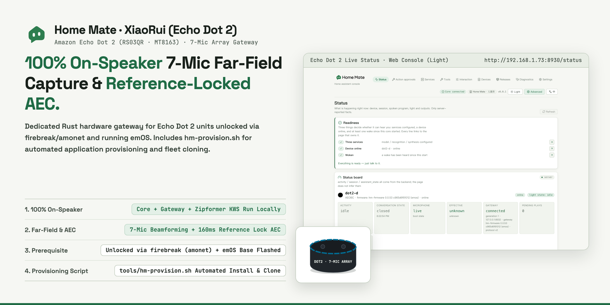
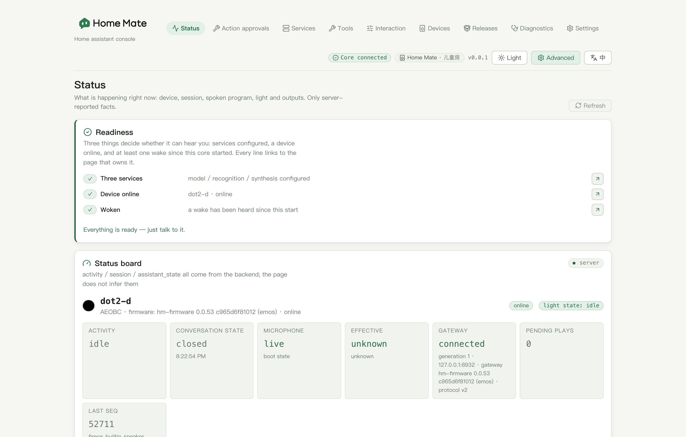
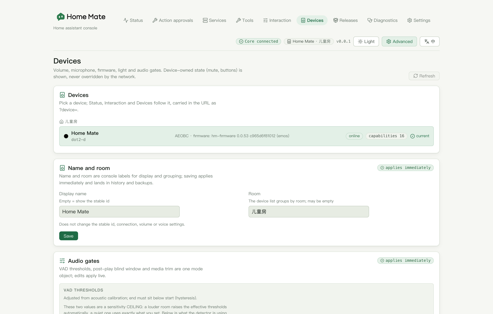

<p align="center">
  
</p>

<p align="center">
  <strong>English</strong> · <a href="README.zh-CN.md"><strong>简体中文</strong></a> · <a href="https://mymate.homes"><strong>Official Website (mymate.homes)</strong></a>
</p>

<p align="center">
  <a href="https://mymate.homes"></a>
  <a href="LICENSE"></a>
  
  
</p>

---

## Overview

This repository contains the dedicated **Home Mate (小瑞 / XiaoRui) Device Gateway** for the 2nd-Generation Amazon Echo Dot (`RS03QR` "Biscuit" / MediaTek `MT8163` `aarch64`, 512 MB RAM, 7-microphone far-field array) running an unlocked `emOS` audio base.

> [!IMPORTANT]
> **Hardware Research Disclaimer & Custom Speaker Roadmap**
> 1. **For Research & Personal Experimentation Only**: Adaptation of the **Amazon Echo Dot 2 (`RS03QR`)** in this repository is provided **strictly for edge-AI architectural research, 7-mic far-field AEC/arbitration validation, and personal non-commercial experimentation**. All trademarks belong to Amazon.com, Inc. This project is not affiliated with Amazon and **does not sell modified third-party brand-name speakers**.
> 2. **First-Party Custom Speaker Under Active Development**: We are actively engineering a **dedicated custom Home Mate (小瑞) smart speaker hardware platform** featuring an open far-field microphone array, tuned acoustic enclosure, and native sovereign Rust firmware out of the box—requiring zero third-party unlock steps.

As the pure-Rust evolution of [rui (小瑞)](https://github.com/yes999zc/rui), it runs **100% on the Echo Dot 2 speaker hardware itself** without needing an external Docker streaming host:
- **7-Mic Far-Field Array + 160ms Reference AEC Lock**: Captures multi-channel microphone and playback reference streams with 160ms tail alignment (`effective_tail_samples = 2560`) and reference lock health telemetry.
- **12-LED RGB Ring & Physical Buttons**: Drives the 12-pixel RGB ring at 60fps (wake direction pointer, thinking pulse, volume bar, muted red privacy latch) and handles physical Action / Volume / Mic-Mute buttons.
- **Multi-Unit Acoustic Calibration**: Supports per-unit `mic_gain_offset_db` calibration and the `echomuse` 2-inch driver voicing EQ curve for accurate cross-room SNR wake arbitration across a multi-room fleet.

---

## Live Web Console & Architecture (Light Theme Default · `:8930`)

<table>
  <tr>
    <td width="50%">
      
      <p align="center"><strong>Echo Dot 2 Status Overview (<code>/status</code>)</strong><br>Connection generation, 7-mic capture state, and Northbound v2 protocol telemetry</p>
    </td>
    <td width="50%">
      
      <p align="center"><strong>Echo Dot 2 Hardware &amp; Audio Gate (<code>/devices</code>)</strong><br>Room assignment, Silero VAD dBFS thresholds, and 2-inch driver EchoMuse EQ</p>
    </td>
  </tr>
</table>

<p align="center">
  
</p>

---

## Required Prerequisites & 1-Command Provisioning (`tools/hm-provision.sh`)

### Required Prerequisites (Check Before Provisioning)
1. **Bootrom Unlocked via `firebreak` (`amonet`)**: Your 2nd-Generation Echo Dot (`RS03QR`) must first be unlocked over Micro-USB using [yes999zc/firebreak](https://github.com/yes999zc/firebreak) (`uvx firebreak@latest`) with your stock `p10` partition backed up.
2. **`emOS` Audio Base Flashed & Connected to Wi-Fi**: The speaker must be running the `emOS` system layer (so the USB serial console `/dev/cu.usbmodem*` on macOS or `/dev/ttyACM*` on Linux reports `ID=emos`) and joined to your LAN via `em-wifi`.

### Option 1: Let an AI Coding Agent Provision Echo Dot 2 For You (Recommended)
Copy and paste this prompt into **Claude Code, Cursor, or Codex** *(remember to replace the example serial device and IPs with your own actual values!)*:
```text
I have an Amazon Echo Dot 2 (RS03QR) already unlocked via firebreak (amonet) and running the emOS audio base:
[IMPORTANT: Replace the example serial device and LAN IPs below with your own actual values]
- USB Serial Port: /dev/cu.usbmodem8401   <-- Replace with your actual USB serial device (or detect via `ls /dev/cu.usbmodem* /dev/ttyACM*`)
- Speaker LAN IP:  192.168.1.73           <-- Replace with your Echo Dot 2's actual Wi-Fi LAN IP
- (Optional) Reference Speaker IP: 192.168.1.50 <-- Replace with an existing configured speaker's IP if cloning household config

In the `home-mate` repository, please run `./tools/hm-provision.sh` to provision this speaker as `--device-id dot2-living` with `--wake-word 你好小智`:
1. Run `./tools/hm-provision.sh` with `--dry-run` first to verify serial reachability (`ID=emos`), `/data/emos/sockets`, and package hashes. Report the dry-run output before making changes.
2. Run `./tools/hm-provision.sh` without `--dry-run` (passing `--reference-node <REF_ID> --reference-ip <REF_ACTUAL_IP>` if a reference speaker exists) to install the seed, activate the signed release, verify 7/7 health checks, and save the token to `~/.home-mate/dot2-living.token`.
```

### Option 2: Manual Provisioning & Cross-Compilation
```bash
# Cross-compile hm-gateway for Echo Dot 2 (aarch64):
cargo zigbuild --release --target aarch64-unknown-linux-gnu.2.19 -p gateway

# Provision an unlocked emOS Echo Dot 2 from the home-mate Core repository:
./tools/hm-provision.sh --device-id dot2-living \
  --seed build/bootstrap/home-mate-bootstrap-dot2-living.tar.gz \
  --release build/release/home-mate-release-2026.11.23-106.tar \
  --serial /dev/cu.usbmodem8401 --ip 192.168.1.73 \
  --reference-node lx06 --reference-ip 192.168.1.50 --wake-word 你好小智
```

---

## Acknowledgments

- [wilbowes/EchoMuse](https://github.com/wilbowes/EchoMuse) — State machine, 2-inch driver voicing curve insights (`echomuse` EQ preset), and explainable-wizard console philosophy (no code copied).
- [k2-fsa/sherpa-onnx](https://github.com/k2-fsa/sherpa-onnx) (Apache-2.0), [Microsoft ONNX Runtime](https://github.com/microsoft/onnxruntime) (MIT), [snakers4/silero-vad](https://github.com/snakers4/silero-vad) (MIT), and [xiph/speexdsp](https://github.com/xiph/speexdsp) (BSD-3-Clause).
- [yes999zc/rui (小瑞)](https://github.com/yes999zc/rui) — The first-generation predecessor of Home Mate.

---

## License & Contact

- **License**: **[GNU AGPL v3.0](LICENSE)** (Northbound Protocol v2 wire contract under **[Apache-2.0](LICENSE-PROTOCOL-APACHE-2.0)**).
- **Official Website**: **[https://mymate.homes](https://mymate.homes)**
- **Contact**: **`zhangcong1985@gmail.com`** / **`yes999zc@163.com`**
