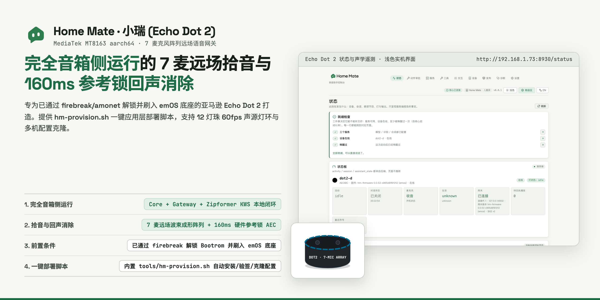
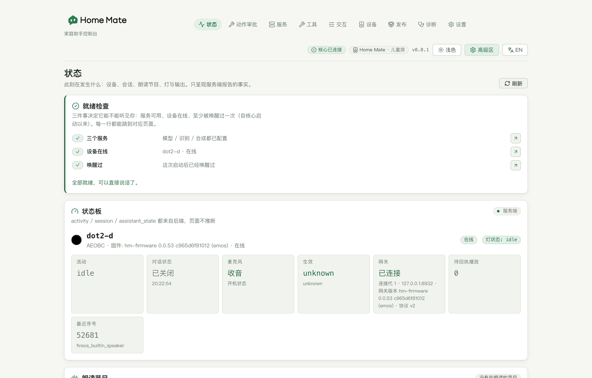
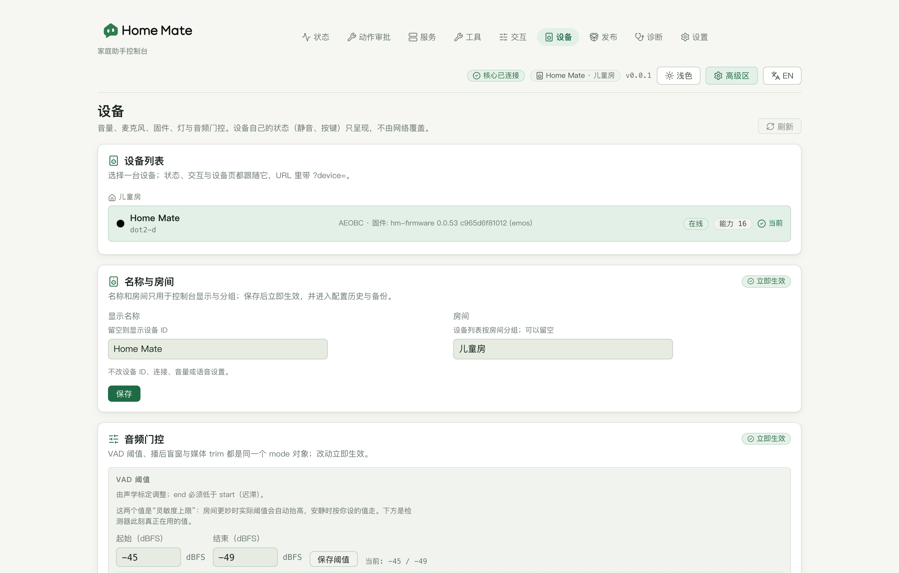

<p align="center">
  
</p>

<p align="center">
  <a href="README.md"><strong>English</strong></a> · <strong>简体中文</strong> · <a href="https://mymate.homes"><strong>官方网站 (mymate.homes)</strong></a>
</p>

<p align="center">
  <a href="https://mymate.homes"></a>
  <a href="LICENSE"></a>
  
  
</p>

---

## 项目简介

本仓库是 **Home Mate（中文名：小瑞）** 针对**亚马逊第二代 Echo Dot（`RS03QR` "Biscuit"，MediaTek `MT8163` 四核 `aarch64`，512 MB 内存，7 麦克风远场阵列）**打造的专属 Rust 硬件网关。

> [!IMPORTANT]
> **硬件研究用途声明与自研定制音箱计划**
> 1. **存量音箱仅作技术研究使用**：本仓库对**亚马逊 Echo Dot 2（`RS03QR`）**的适配代码与配网脚本，**仅作为端侧纯 Rust 语音架构研究、7 麦阵列回声消除/多房间声学仲裁验证与个人非商业实验用途**。相关品牌与型号商标均归原厂商所有，本项目与亚马逊公司无任何关联，**亦不售卖任何改装版第三方品牌音箱**。
> 2. **正在开发原生定制音箱**：我们正在自主研发**专为 Home Mate · 小瑞 打造的原生定制智能音箱硬件**（开放式远场多麦克风阵列、定制高保真声学腔体、出厂原生搭载主权 Rust 语音系统，无需任何第三方解锁前置步骤），敬请期待。

作为 [小瑞 · rui](https://github.com/yes999zc/rui) 的下一代纯 Rust 重写演进版，它将核心大脑、网关与离线热词引擎 **100% 运行在 Echo Dot 2 音箱本体上**，无需外部 Docker 推流主机：
- **7 麦克风远场拾音 + 160ms 硬件参考锁回声消除（AEC）**：同步采集多通道麦克风与播放回采参考流（`effective_tail_samples = 2560`），支持播放中语音热词打断。
- **12 灯珠 60fps RGB 灯环与实体按键**：完整驱动顶部 12 颗 RGB 灯珠（声源方向指针、思考呼吸、音量弧、物理静音红环）及顶部 Action / 音量 / 静音键。
- **单机麦克风增益标定与 2 寸喇叭专属 EQ**：内置针对 2 寸小喇叭实测校正的 `echomuse` 10 段均衡曲线，并支持每台设备独立保存 `mic_gain_offset_db` 增益偏移，实现 5 台以上多房间精准声学信噪比（SNR）唤醒仲裁。

---

## 实机控制台界面与架构（默认浅色主题 · `http://<Dot2_IP>:8930`）

<table>
  <tr>
    <td width="50%">
      
      <p align="center"><strong>Echo Dot 2 状态总览 (<code>/status</code>)</strong><br>服务就绪自检、北向 v2 连接代次与 7 麦收音状态</p>
    </td>
    <td width="50%">
      
      <p align="center"><strong>Echo Dot 2 硬件与音频门控 (<code>/devices</code>)</strong><br>房间分组、Silero VAD 分贝门限与 2 寸喇叭 EchoMuse 曲线</p>
    </td>
  </tr>
</table>

<p align="center">
  
</p>

---

## 必备前置条件与一键配网指南 (`tools/hm-provision.sh`)

### 必备前置条件（动手前请逐条核对）
1. **已通过 `firebreak / amonet` 解锁 Bootrom 并获得底层刷写权限**：出厂未解锁的 Echo Dot 2（型号 `RS03QR`）请先使用 [yes999zc/firebreak](https://github.com/yes999zc/firebreak)（执行 `uvx firebreak@latest`）通过 Micro-USB 完成 Bootrom 解锁（解锁前切勿在 Alexa App 联网升级固件），并妥善保存原厂 `p10` 分区备份镜像。
2. **已刷入 `emOS` 音频底座并连上家庭 Wi-Fi**：解锁后需已刷入支持 7 麦阵列拾音的 `emOS` 系统层；此时用 USB 数据线连接电脑会出现串口控制台（macOS 为 `/dev/cu.usbmodem*`，Linux 为 `/dev/ttyACM*`，串口 `/etc/os-release` 返回 `ID=emos`），并在串口执行 `em-wifi` 连上家庭局域网。

### 方式一：让 AI 编程助手（Claude Code / Cursor / Codex）代你一键刷入与克隆（推荐）
直接把下面这段话复制给你的 AI 助手（**注意：复制后请把话术里的示例串口和示例 IP 替换为你自己的真实值**）：
```text
我有一台已经通过 firebreak (amonet) 解锁并刷好 emOS 音频底座的亚马逊 Echo Dot 2：
【请先将下方示例串口与示例 IP 替换为你自己的真实值】
- USB 串口设备：/dev/cu.usbmodem8401  <-- 替换为你电脑识别到的实际串口（或让 AI 执行 ls /dev/cu.usbmodem* /dev/ttyACM* 自动查找）
- 音箱局域网 IP：192.168.1.73         <-- 替换为你这台 Echo Dot 2 通过 em-wifi 连上后的实际局域网 IP
- （可选）家里已配好的参考音箱 IP：192.168.1.50 <-- 如需克隆已有节点配置，请替换为参考节点的实际 IP

请帮我在 `https://github.com/yes999zc/home-mate` 仓库下使用 `./tools/hm-provision.sh` 完成这台新节点（节点 ID 设为 `dot2-living`，唤醒词设为 `你好小智`）的应用层部署：
1. 先加上 `--dry-run` 参数运行一次 `./tools/hm-provision.sh`，向我展示串口 `ID=emos` 核验、`/data/emos/sockets` 状态、wlan0 IP 与将要执行的计划，确认 0 报错后再继续。
2. 去掉 `--dry-run` 正式执行 `./tools/hm-provision.sh`（若我上面提供了参考节点 IP，请加上 `--reference-node <参考节点ID> --reference-ip <参考节点真实IP>`），自动完成 bootstrap 种子包安装、重启交由 emOS init 守护、Ed25519 签名 release 包激活、7/7 健康自检与全屋配置克隆，并将生成的令牌保存到 `~/.home-mate/dot2-living.token`。
```

### 方式二：手工执行 `tools/hm-provision.sh` 与交叉编译
```bash
# 交叉编译 Echo Dot 2 网关二进制 (aarch64)：
cargo zigbuild --release --target aarch64-unknown-linux-gnu.2.19 -p gateway

# 在 home-mate 主仓使用 hm-provision.sh 一键完成新节点引导、验签激活与全屋配置克隆：
./tools/hm-provision.sh --device-id dot2-living \
  --seed build/bootstrap/home-mate-bootstrap-dot2-living.tar.gz \
  --release build/release/home-mate-release-2026.11.22-98.tar \
  --serial /dev/cu.usbmodem8401 --ip 192.168.1.73 \
  --reference-node lx06 --reference-ip 192.168.1.50 --wake-word 你好小智
```

---

## 致谢

- [wilbowes/EchoMuse](https://github.com/wilbowes/EchoMuse) —— 设备管理控制台的状态机、「可解释向导」思路以及 Echo Dot 2 2 寸喇叭声学补偿参考（未复制代码）。
- [k2-fsa/sherpa-onnx](https://github.com/k2-fsa/sherpa-onnx)（Apache-2.0）、[Microsoft ONNX Runtime](https://github.com/microsoft/onnxruntime)（MIT）、[snakers4/silero-vad](https://github.com/snakers4/silero-vad)（MIT）与 [xiph/speexdsp](https://github.com/xiph/speexdsp)（BSD-3-Clause）。
- [yes999zc/rui（小瑞）](https://github.com/yes999zc/rui) —— Home Mate 的第一代前身项目。

---

## 开源协议与联系方式

- **开源协议**：**[GNU AGPL v3.0](LICENSE)**（北向 Protocol v2 通信协议规范遵循 **[Apache-2.0](LICENSE-PROTOCOL-APACHE-2.0)**）。
- **官方网站**：**[https://mymate.homes](https://mymate.homes)**
- **联系作者**：**`zhangcong1985@gmail.com`** / **`yes999zc@163.com`**
